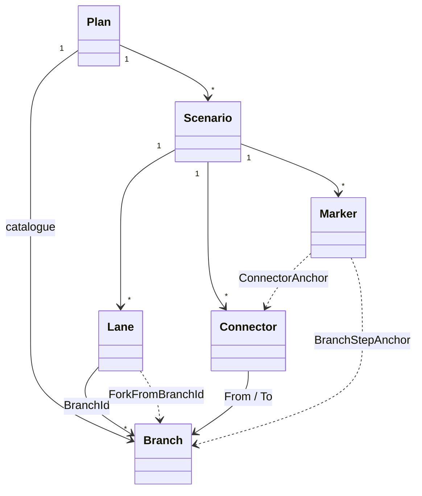

# Domain model

Source of truth: `docs/Design.md` section 2 (v0.2). The model is **data only**: the app never blocks an edit because of a business rule (decision D1). Code: `src/IntegrationPlanner.Core/Model`.

## Entities

| Entity | Fields | Notes |
|---|---|---|
| `Plan` | `Title`, `Branches`, `Scenarios` | One file. `schemaVersion` exists only in the file format, not on the model. |
| `Branch` | `Id`, `Name`, `Summary`, `IsMainline`, `IsCancelled`, `JiraKey?` | Shared catalogue across all scenarios. `IsMainline` and `IsCancelled` only affect styling. `JiraKey` is the Jira ticket the branch was created from (null otherwise). |
| `Scenario` | `Id`, `Name`, `StepCount`, `Lanes`, `Connectors`, `Markers` | One diagram. The horizontal axis is ordered steps; there are no dates (D7). |
| `Lane` | `BranchId`, `Order`, `StartStep`, `EndStep?`, `ShowFork`, `ForkFromBranchId?`, `ForkStep?` | Places a branch in a scenario. `Order` < 0 is above the mainline, > 0 below. No `EndStep` means "to the last step". The fork line is optional (D5). |
| `Connector` | `Id`, `Kind` (Pull, Merge), `FromBranchId`, `ToBranchId`, `Step`, `Label?`, `State` | May connect any two branches (D3). |
| `Marker` | `Id`, `Kind` (ReleaseBuild, IntegrationTest, Testing, Custom), `Label`, `Anchor`, `Angle` (degrees, 0 = from the left, clockwise), `Length`, `State` | Anchored to a branch at a step (`BranchStepAnchor`) or to a connector (`ConnectorAnchor`) (D6). |

`State` is `Planned` or `Done` (D8); rendering draws Planned dashed and Done solid.

## Identity

IDs (`BranchId`, `ScenarioId`, `ConnectorId`, `MarkerId`) are readable strings, so plan files stay diff-friendly in git. `New()` generates a GUID-based ID for new items.

## Data consistency (not business rules)

Only references are kept consistent:

| Action | Effect |
|---|---|
| Delete branch | Removed from the catalogue and, in every scenario, its lane, the connectors involving it, the markers anchored to it or to those connectors, and the fork of lanes forked from it. |
| Remove lane | Same cascade, limited to one scenario. |
| Delete connector | Markers anchored to it are removed. |
| Load a file with dangling references | The dangling items are dropped and reported (`DroppedReference`). |

Editing commands also reject references to items that do not exist (for example a connector to an unknown branch) and duplicate IDs; these are programming errors, not rule violations. Every cascade is a single undoable step.
